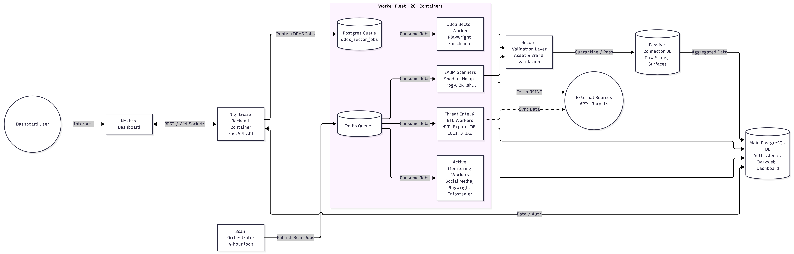
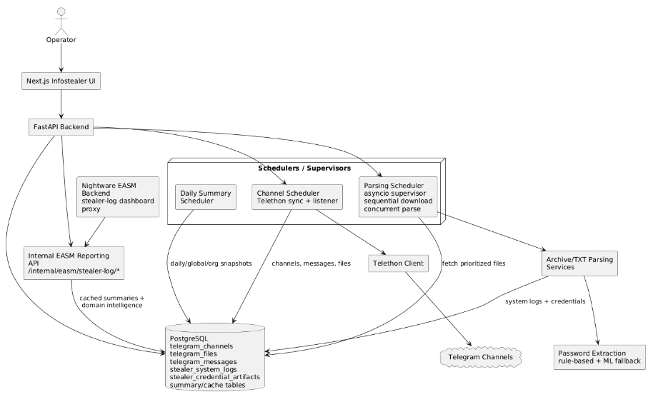
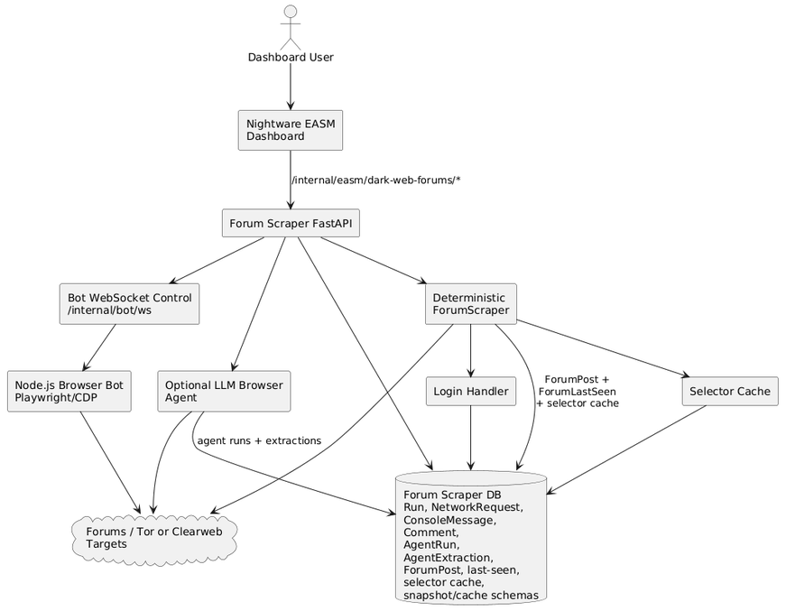
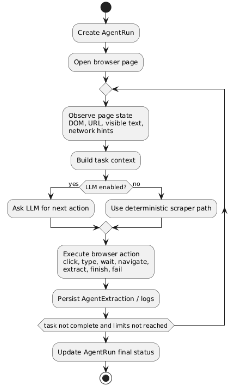

# Knowledge Document

## Table of Contents
* [EASM Module - Overview](#easm-module---overview)
* [Infostealer Module - Overview](#infostealer-module---overview)
* [Dark Web Forum Monitoring Module - Overview](#dark-web-forum-monitoring-module---overview)
* [Manual Change Logs](#manual-change-logs)

---

## EASM Module - Overview
External Attack Surface Mapping Module with the central dashboard. It maps and visualizes an organization's external attack surface. It currently runs a decoupled 4-hour scan cycle through a standalone orchestrator process, Redis-backed scan workers, and a Postgres-backed DDoS sector enrichment worker, enriching the data with CVE intelligence and presenting it through a multi-surface dashboard.

### Technologies
| Layer | Stack |
| :--- | :--- |
| **Backend Workers** | Python 3.11, FastAPI, SQLAlchemy 2.0, PostgreSQL 16, Redis 5+, Playwright, Telethon, STIX2, PYOTP. Standalone orchestrator + 20+ Redis-backed workers (EASM scanners, ETL pipelines, social media/Telegram scrapers, Threat Intel, Alerting). |
| **Frontend** | Next.js 15, React 19, TypeScript 5, Tailwind CSS 4, ECharts (2D/3D), Vitest. |
| **OSINT** | Shodan, Nmap, DNSTwist, Sherlock, Frogy, crt.sh, google-play-scraper. |
| **CVE Data** | NVD API v2.0, CISA KEV, Exploit-DB, ThreatFox, MISP, OTX. |
| **Email** | Amazon SES (SMTP/STARTTLS) with DKIM validation. |

### Architecture

*   **Dual DB Architecture:**
    *   **Main Engine:** Handles auth, onboarding, darkweb, ransomware, DDoS targets, Nmap results, notifications, and VIP/TTR.
    *   **Passive Engine:** Houses dynamic per-scan tables, current materialized EASM surfaces, and validation/quarantine tables. Defaults to the main Postgres URL unless `PASSIVE_CONNECTORS_DATABASE_URL` is explicitly overridden.
*   **Runtime Split (RUN_MODE):** The backend container serves multiple purposes based on the injected environment variable:
    *   `RUN_MODE=api`: Starts the `uvicorn app.main:app` server for REST/WebSocket traffic.
    *   `RUN_MODE=orchestrator`: Starts the multi-threaded dispatch schedulers.
    *   `RUN_MODE=worker`: Starts a designated scan worker based on the `SCAN_TYPE` variable (e.g., `shodan`, `nmap`, `social_media`).
*   **Specialized Workers:** Dedicated modes for custom ETL and monitoring loops, including `ddos_sector_worker`, `nvd_etl_worker`, `enrichment_etl_worker`, `situational_awareness_worker`, `easm_alert_listener`, and `stealer_log_poller_worker`.
*   **Orchestration & Scheduling:** The orchestrator (`app.orchestrator_main`) has evolved beyond a single 4-hour loop. It now manages three independent schedulers:
    *   **EASM Scan Scheduler:** Dispatches the standard 4-hour passive and active EASM scan phases via Redis (`{scan_type}:jobs`).
    *   **Social Media Scheduler:** Dispatches Playwright scraping tasks based on dynamic interval settings.
    *   **Org Bootstrap Dispatcher:** A fast-polling loop that instantly triggers initial scans when a new client organization is onboarded.
*   **Validation Layer:** Passive current/reporting records pass through strict asset and brand validation gates (`asset_validation_service.py`, `brand_validation_service.py`) before becoming actionable rows in the Main DB.
*   **Auth & Security:** Powered by PBKDF2 password hashing, secure session tokens, and strict Role-Based Access Control (RBAC) supporting systemAdmin, orgAdmin, executiveViewer, and analystIt roles. Includes native TOTP 2FA (via PyOTP) and email verification.

### Current worker matrix
| SCAN_TYPE | Handler | Role | Validation / gating |
| :--- | :--- | :--- | :--- |
| **shodan** | `run_shodan_scan_sync` | Shodan asset/service/CVE discovery and Shodan-derived EASM surfaces | Active asset validation for live/public domain and network rows |
| **crtsh** | `run_crtsh_scan_sync` | Certificate Transparency and certificate/subdomain surface | Historical CT evidence, not live-asset gated |
| **nmap** | `run_nmap_scan_sync` | Active port/service validation and network exposure enrichment | Nmap scan output is active service evidence |
| **dnstwist** | `run_dnstwist_scan_sync` | Typosquatting and brand impersonation domain discovery | Brand validation adds validation_status, reason, confidence, evidence, HTTP/page/screenshot metadata |
| **frogy** | `run_frogy_scan_sync` | External Frogy pipeline, raw artifacts, and normalized EASM surface rows | Active asset validation for live/public rows; evidence/config rows retained |
| **ransomware** | `run_ransomware_scan_sync` | Global ransomware feed ingestion into passive/current ransomware tables | Feed/import normalization, not asset/brand gated |
| **cloud_exposure** | `run_cloud_exposure_scan_sync` | Shodan-derived cloud storage/IAM/networking exposure surfaces | Evidence/config surfaces carry metadata but are not forced through live-asset gate |
| **ddos** | `ingest_ddosia_data` | DDoSia feed ingestion and enqueueing of sector enrichment work | Sector validation/enrichment happens in the Postgres-backed sector worker |
| **sherlock** | `run_sherlock_scan_sync_with_override` | Social/persona account discovery | Brand validation classifies social findings as validated/observation/quarantined |
| **mobile** | `run_impersonating_app_scan_sync` | Google Play impersonating app discovery | Brand validation classifies mobile impersonation findings |
| **Social media** | `run_social_media_collection_for_org` | Playwright-based scraping and monitoring for Facebook/X (Twitter) targets | Brand validation classifies social findings |

### Current EASM data flow
1.  **Multi-Threaded Orchestration:** `RUN_MODE=orchestrator` utilizes three distinct schedulers (EASM, Social Media, Org Bootstrap) to load targets and publish Redis jobs by scan type.
2.  **Task Consumption:** `RUN_MODE=worker` instances consume `{scan_type}:jobs` from Redis, executing their specific sync handlers (e.g., `run_social_media_collection_for_org`). Upon completion, they publish status to `{scan_type}:result:{job_id}` and `{scan_type}:results`. Specialized background workers (e.g., `nvd_etl_worker`, `stealer_log_poller_worker`) bypass Redis and execute their own continuous polling loops.
3.  **Passive Ingestion & Enrichment:** Connectors write raw source rows and derived surfaces to the `passive_engine`.
    *   Shodan & Frogy populate multiple EASM surfaces.
    *   CRT.sh feeds digital_certificates.
    *   DNSTwist, Sherlock, Mobile, and Social Media feed canonical brand-intelligence alerts.
    *   Ransomware and DDoSia write directly to threat-intelligence tables.
4.  **Validation Gates:** Records pass through validation before becoming actionable in the Main DB: active asset validation gates live/public domains, brand validation classifies impersonation/social alerts, and DDoS feeds trigger the Postgres-backed Playwright sector enrichment worker.
5.  **Aggregation & Exposure:** The `executive-metrics-aggregator-worker` pre-calculates dashboard metrics, and dedicated API read services expose the final, normalized materialized views to the Next.js frontend.

### What Exists

**Backend (current registered FastAPI routers and services)**
*   **Orchestration & Workers:** Multi-threaded orchestrator (EASM, Social Media, Org Bootstrap) managing 20+ Redis-backed workers. Includes core EASM (Shodan, crt.sh, Nmap, DNSTwist, Sherlock, ransomware, mobile app, cloud exposure, Frogy, DDoS) alongside active monitoring (Social Media scraper, Infostealer poller, Alert listener) and global ETL pipelines (NVD, Exploit-DB, IOC ingestion, Situational Awareness).
*   **API Security & Lifecycle:** Driven by `Depends(require_session_token)` for UI fetching endpoints and `Depends(require_api_key)` for internal/scan operations. Features native thread-pooling management, Redis realtime relays, and idle database connection keepalives on startup.
*   **Aggregate/Read Surfaces (Protected by Session Token):**
    *   Domain, Certificates, Network Exposure, Public-Facing APIs, Login Interfaces, Network Configuration, Cloud Exposure, Vulnerability Exposure, Tech Stack, and AI Exposure.
    *   Typosquatting, Social Media, Darkweb Monitoring, and Brand Takedown.
    *   Situational Awareness, Threat Actors, IOCs, STIX, Threat Research, VIP Reports, Stealer Logs, Ransomware, DDoS Monitoring, and Threat Intelligence Feeds.
    *   Executive Dashboard, Reports, Account Settings, Users, Organization Keywords, and internal Admin panels (Feeds, VIP Reports, Takedown Management).
    *   Dedicated API routes for managing client onboarding (Keywords, Software Assets, People, Domains, IPs, Exclusions, and Third-Party Domains).
*   **Scan Trigger Endpoints (Protected by API Key):** Explicit operational routes to manually trigger Shodan, Nmap, crt.sh, DNS Twist, Sherlock, Ransomware ingestion, Impersonating Apps, and Cloud Exposure.
*   **Record Validation:** Active asset validation for live/public passive assets, brand-intelligence validation for takedown-ready impersonation records, quarantine storage for noisy/failed records.
*   **Notifications:** Per-scan alerts with email delivery, deduplication, status updates, and live WebSocket support at `/ws/notifications` (with dedicated token auth).
*   **Auth System:** Registration, login, email verification, org management, user roles, session management, account settings, login history, and TOTP 2FA.

**Frontend (Live & Integrated Components)**
*   **EASM & Core Surfaces:** External Attack Surface, Cloud Exposure, Vulnerability Intelligence, Alert Center.
*   **Brand & Threat Modules:** Brand Intelligence, VIP/TTR, Dark Web, DDoS, Ransomware, Stealer Log.
*   **Dashboards & Operations:** Executive Dashboard (now featuring the live Situational Awareness Attack Map), Settings, Notifications.

### Production Readiness Scorecard
| Component | Score | Status |
| :--- | :--- | :--- |
| **Shodan Scanner + CVE Enrichment** | 9/10 | Prod Ready |
| **Vulnerability Exposure Surface** | 9/10 | Prod Ready |
| **CRT.sh / Nmap / DNSTwist Scanners** | 9/10 | Prod Ready |
| **Domain / Network / Cert / Tech Stack Surfaces** | 9/10 | Prod Ready |
| **Auth, Notifications, Email** | 7/10 | Mostly Ready |
| **Frontend: EAS, Vuln Intel, Alert Center** | 9/10 | Prod Ready |
| **Scan Orchestrator** | 8/10 | Standalone process, Redis queues, lock, phased dispatch; timeout/retry policy still limited |
| **Sherlock Scanner** | 6/10 | Needs Work |
| **Mobile App Scanner** | 8/10 | Prod Ready |
| **CI/CD Pipeline** | 5/10 | Needs Work - Tests exist but pipeline ignores them. |
| **Frontend: Executive View / Threat Intel** | 9/10 | Live endpoints wired. Mock data explicitly disabled. |
| **Test Coverage** | 7/10 | Backend test suite now covers many services/routes; CI execution should still be verified |

### Frontend → Backend Gap (current remaining gaps, not 40+ missing endpoints)
Many endpoints previously listed as missing now exist. The current gap is limited to specific aggregate or mock-backed areas:

| Feature Area | Current Backend State | Frontend Hook/Service | Fallback Behavior |
| :--- | :--- | :--- | :--- |
| **Stealer Log (Org/Global)** | Implemented under `/fetching/stealer-log/*`; proxies Infostealer internal reporting when configured and otherwise returns stable empty/stub payloads | `useOrganizationStealerData.ts`, `useGlobalStealerData.ts` | Stub/empty fallback inside backend service |
| **Vuln Intel Insights** | Insights endpoint not found; base vulnerability exposure endpoints exist | `VulnIntelService.ts` | Mock insights fallback |

### What Else Is Missing
*   No password reset - frontend page exists, no backend endpoint found.
*   2FA backend exists for TOTP - account settings exposes setup/verify/disable endpoints; SMS 2FA UI should be treated separately if still present.
*   No rate limiting on API endpoints.
*   No audit logging, no data retention/cleanup policy.

### Key Issues to Fix Before Production
1.  **CORS:** `allow_origins=["*"]` overrides the whitelist - security risk.
2.  **Nmap risk scores:** Currently `random.choice()` - must use real CVE data.
3.  **Debug endpoint:** `GET /debug-file` exposes internal paths.
4.  **Duplicate function** in `sherlock_scan_service.py`.
5.  **No loading indicators** in frontend.
6.  **Org status** returns `random.choice(["premium", "free"])` - mock logic.

---

## Infostealer Module - Overview

### Purpose
Collect all leaked information from Telegram channels (stealer logs, credential dumps, archives) into a single unified database. Search by domain to find what's been exposed for any customer. Rule: never delete data, only add.

### Tech Stack
| Layer | Technology |
| :--- | :--- |
| **Frontend** | Next.js 16, React 19, Tailwind CSS 4, TypeScript |
| **Backend** | FastAPI, Uvicorn, Python |
| **Telegram** | Telethon + Fast Telethon Helper (encrypted stream protocol) |
| **ML** | PyTorch, HuggingFace Transformers (DistilBERT - CPU-only password detection) |
| **Database** | PostgreSQL 16 (SQLAlchemy 2.0) |
| **Archives** | rarfile, unrar (archive extraction), pyzipper |
| **Email** | Amazon SES (SMTP) |
| **Containers** | Docker Compose (3 services: backend, frontend, postgres) |
| **Security/Scanning** | yara-python |

### Architecture

### What Exists - Production Readiness
| Feature | Status | Score | Notes |
| :--- | :--- | :--- | :--- |
| **Telegram Bot / Client** | Working | 7/10 | Telethon stream, auto-reconnect, flood sleep threshold. Sleeps under heavy load |
| **Channel Sync** | Working | 8/10 | Initial sync + real-time event handler via encrypted WebSocket-like protocol |
| **Message Storage** | Working | 8/10 | Full channel history, file metadata, dedup by (channel_id, message_id) |
| **Archive Download** | Working | 7/10 | Single download at a time (Telegram limit), SHA256 hashing, status tracking |
| **Archive / TXT Parsing** | Working | 7/10 | Current V2 parser engine runs in a shared ProcessPoolExecutor; archive inspection uses 7zz, parser output is imported through optimized Postgres COPY paths |
| **Password Extraction** | Working | 7/10 | Hybrid: regex rules + DistilBERT ML fallback for ambiguous messages; captured values strip wrappers such as markdown/backtick formatting |
| **Credential Storage** | Working | 8/10 | Deduped (system_log_id, software, host, username). Per-machine tracking |
| **Search API** | Working | 6/10 | ILIKE search across fields. Indexing exists. Needs optimization |
| **Auto-Recovery** | Working | 7/10 | On startup: resets stuck downloads, cleans partial files, preserves sessions |
| **Email Alerts** | Working | 7/10 | 5 consecutive failures, channel sync issues, recovery, reconnect, daily summary |
| **Log Streaming** | Working | 8/10 | SSE endpoint + in-memory ring buffer, real-time log viewer in frontend |
| **Daily Stats** | Working | 7/10 | Daily Stats Snapshot: credentials/systems/messages/channels added per day |
| **Dev/Prod Modes** | Working | 8/10 | DEV_MODE flag, local vs external Postgres, migration script |
| **Empty Channel Cleanup** | Missing | 0/10 | Sync logic only upserts (INSERT ON CONFLICT DO UPDATE); stale/deleted channels are never dropped from the database. |
| **Frontend Dashboard** | Partial | 5/10 | 5 pages exist but likely need UI polish, no auth |
| **YARA Malware Detection** | Implemented in parser path | 6/10 | Parser worker compiles YARA rules once per child process and imports detections into `stealer_malware_detections`; rule quality/coverage still depends on the bundled rules |
| **Parser Concurrency** | Process-pool based | 6/10 | Scheduler is in-process asyncio; parse execution uses `PARSER_POOL_WORKERS` child processes, not Celery/distributed workers |
| **VIP Account Optimization** | Partial / File-level only | 4/10 | True account-level routing is missing. However, a file-level priority queue (`TelegramFilePriority`) is actively implemented in the scheduler to delay backlog files and prioritize fresh .txt payloads |
| **Authentication** | Missing | 0/10 | No frontend auth, open access to API |
| **Nightware Integration** | Implemented | 7/10 | Internal `/internal/easm/stealer-log/*` reporting endpoints and EASM cache/summary tables exist |

**Overall Readiness: 6/10** - Core pipeline works (collect -> download -> inspect -> parse in process pool -> import -> search) and EASM reporting integration exists. Current risk remains around parser rule coverage, search performance at scale, auth boundary, and the in-process scheduler model.

### Current Backend Inventory
| Area | Current Files / Behavior |
| :--- | :--- |
| **Repositories** | `channels.py`, `files.py`, `messages.py`, `stealer_log.py`, and `channel_storage_snapshots.py` under `backend/app/repositories/` |
| **Repository coverage** | Channel upsert/listing, file metadata/status/hash updates, message sync and scheduler selection, stealer credential/system-log search, table row estimates, and channel storage snapshot upsert |
| **Maintenance scripts** | Credential search index creation/progress/maintenance, dedupe scripts, local-to-external migration, MongoDB legacy import, DB sync, email-field scrub, session termination, and watchdog |
| **Current backfill/cache scripts** | `backfill_org_credential_snapshots.py`, `backfill_global_dashboard_snapshots.py`, and `update_easm_cache.py` support EASM dashboard reporting tables |
| **Current table creation scripts** | `scripts/Table_creation_scripts/create_telegram_file_priorities_table.py` and `scripts/Table_creation_scripts/create_stealer_malware_detections_table.py` |
| **Internal EASM reporting auth** | `/internal/easm/stealer-log/*` checks `X-Internal-API-Key` only when `INTERNAL_EASM_API_KEY` is configured; empty key runs in compatibility mode |
| **DB bootstrap** | `init_db()` creates models and adds missing production columns/constraints for parser-era fields such as `stealer_type`, `risk_score`, `filepath`, and credential dedupe |

### Frontend → Backend Gap (current integration status)
The old broad "missing endpoints" framing is no longer accurate for this module. Infostealer now exposes internal EASM reporting endpoints under `/internal/easm/stealer-log/*`, and the EASM backend has stealer-log proxy/fallback routes. The remaining work is deployment configuration, internal API protection, and parser/reporting quality hardening.

### What Is Missing
*   **Parser/YARA rule coverage validation** - YARA execution and detection storage are implemented in the parser process-pool path; the remaining work is feed-by-feed rule quality validation.
*   **Distributed parser fleet** - local process-pool parsing exists via `PARSER_POOL_WORKERS`; no Celery/distributed parser fleet exists.
*   **VIP Telegram account optimization** - not implemented as a separate backend optimization path.
*   **Parser coverage validation** - V2 handles archives and direct .txt files through a shared engine, but unusual channel/feed formats still need tests and parser rule tuning.
*   **Frontend/API authentication boundary** - EASM auth exists; Infostealer's own admin/API exposure should still be reviewed and protected before production use.
*   **Nightware EASM integration hardening** - internal reporting endpoints and cache tables exist; deployment must configure the EASM backend `INFOSTEALER_API_BASE_URL` and secure the internal API boundary.
*   **Search optimization** - pre-aggregation and index maintenance scripts exist, but raw ILIKE queries in `stealer_log.py` may still cause synchronous bottlenecks at scale.
*   **Rate limiting** - no protection on API endpoints.
*   **Empty Channel Cleanup:** While the channel sync pipeline successfully upserts new and existing channel metadata, it currently lacks a deletion or cleanup routine to drop stale or removed channels from the database, meaning the `telegram_channels` table will strictly grow over time.

### Key Issues to Fix Before Production
1.  **Parser quality hardening** - current parser architecture has been replaced by the V2 process-pool engine, but needs fixture-based regression tests for high-volume and unusual feed formats.
2.  **Synchronous blocking operation** - one sync operation in the system causes instability.
3.  **Parser pool/resource tuning** - `PARSER_POOL_WORKERS`, archive size, YARA rules, and import COPY behavior need production load testing.
4.  **Infostealer API exposure** - protect the module/admin endpoints and internal EASM reporting API at deployment.
5.  **Memory usage** - CRITICAL MISMATCH: The backend container is capped at 6GB, but the Python safety gates are set to 9GB (pause) and 11GB (skip). The container will crash from OOM before the safety limits ever trigger.
6.  **CORS:** `allow_origins=["*"]` - same security issue as EASM module.
7.  **Search performance** - ILIKE queries slow on large credential tables.
8.  **Some channels can't be fully read** - deleted messages, no history access.

---

## Dark Web Forum Monitoring Module - Overview

### Purpose
Dark web forums regularly post data breach findings - selling or sharing leaked data. Posts sometimes name the specific organization, sometimes only describe a category (e.g., "Israeli fintech company"). This module's goal is to automatically discover and collect all breach-related posts from these forums, store them in a database, and integrate with the Nightware platform to match findings to monitored organizations.

### Architecture
            Dark Web Forum Monitoring

            Dark Web Forum Scraping

### AI Agent Mode
The system is built on a multi-agent architecture, where each agent has a focused role:

| Agent/Component | Role | Status |
| :--- | :--- | :--- |
| **Deterministic ForumScraper** | Navigates forum pages, detects gates, resolves selectors, extracts thread/post content, persists ForumPost rows, and updates per-domain last-seen state | Implemented |
| **Bot WebSocket Control Plane** | Browser client connects to `/internal/bot/ws`; Python sends open/click/type/JS/screenshot/login-field commands | Implemented |
| **Login Handler** | Detects login gates, fills forms, supports TOTP/email-code paths, waits for feed verification pages, and has partial 2captcha-backed image-captcha/extension support where configured | Implemented |
| **Selector Cache** | Persists per-domain selector choices in `ForumSelectorCache` | Implemented |
| **Browser Agent** | Optional LLM-guided observe/think/act loop that writes AgentRun and AgentExtraction rows | Implemented / optional |
| **EASM Reporting API** | Publishes a rolling 30-day JSON snapshot to a Redis key (`forum_reporting:summary`) for the dashboard to consume. | Implemented |
| **Threat Feed Ingestion** | Imports Dark Web Informer / threat feed records into ForumPost through DTO mapping, optional browser-authenticated JSON fetch, email parsing, and screenshot enrichment | Implemented |

### How It Works
1.  **Run creation:** The API creates an AgentRun through `/agent/scrape`, `/agent/run`, or threat-feed ingestion. Bot-crawler routes use the crawler Run table, but the current Python bot-crawler path calls repository write methods that are not implemented.
2.  **Browser control:** A connected bot receives navigation and interaction commands through `/internal/bot/ws`.
3.  **Execution phase:** The deterministic scraper navigates target pages, retries temporary/loading pages, resolves selectors through config/cache/known-pattern/LLM fallback, handles login gates, and extracts forum posts.
4.  **Storage/reporting:** Extracted posts are stored in `ForumPost`; the scraper skips invalid/error/captcha/non-thread pages before saving and marks saved rows `is_valid=True`. Per-domain cursor state is stored in `ForumLastSeen`; EASM reporting relies entirely on `ForumDailySnapshot` / `ForumDomainDailySnapshot` rollups and does not fall back to live ForumPost queries.

### What Exists
*   **Deterministic ForumScraper** - parses forum pages, identifies thread/post content, and stores posts.
*   **Bot WebSocket command layer** - executes navigation/click/typing/JavaScript/screenshot commands through a connected browser bot.
*   **Login handler, selector cache, crawler history tables, and EASM reporting endpoints**.
*   **Threat feed ingestion paths** - historical JSON import, IMAP email parsing, browser-authenticated feed fetch, DTO mapping, and optional screenshot enrichment for feed posts.

### Current Limitations
*   Browser automation requires a live bot client connected to `/internal/bot/ws`.
*   Complex custom login, CAPTCHA, anti-bot, or 2FA flows can still block scraping. Current CAPTCHA support is partial: image captchas can use 2captcha when configured, and the Node browser can load a local 2captcha extension if present.
*   Selector drift can require cache refresh or target-specific adjustments.
*   EASM reporting freshness depends on completed scraper/agent/feed-ingestion runs. Snapshot tables exist, but the current scraper/ingestion code does not populate them; reporting functions fall back to live ForumPost queries when snapshots are empty.
*   `/bot-crawler/start` and `/bot-crawler/start-sync` currently call `RunRepository.create()`, `update_pages_crawled()`, and `finish()`, but those write methods are not present in `app/repositories/crawler_repository.py`; the legacy `/active/crawler/run/{target}` path starts the external Node crawler process instead.

### What Remains Limited
*   **Classification and relevance logic is narrow** - basic filtering (checking for critical categories and valid victim domains within the last 48 hours) is handled by `forum_ingest_mapper.py`. It does not contain any EASM asset matching logic; it blindly publishes indicators (IOCs) to the event bus and relies entirely on the downstream Nightware EASM module to figure out if the victim matches a client.
*   **Full Nightware integration hardening** - internal EASM reporting endpoints exist and support `X-Internal-API-Key` when configured, but deployment boundaries and matching policy should be verified per environment.
*   **AI-powered search** - LLM support exists for selector discovery and navigation hints, but not as a complete semantic relevance/search engine for indirect organization mentions.

### Implemented / Current Optimization
**Persist reusable scraper state in DB**
The current code stores reusable scraper state in the database. Instead of a standalone `forum_action_plans` table, the implemented model includes selector and cursor/cache tables:
*   `ForumSelectorCache` - domain-specific selector decisions.
*   `ForumLastSeen` - per-domain cursor for last parsed post dates.
*   `ForumDailySnapshot` & `ForumDomainDailySnapshot` - reporting/cache schema tables. Current EASM reporting reads daily/domain snapshots when populated and otherwise falls back to live ForumPost.

### Production Readiness
| Component | Score | Notes |
| :--- | :--- | :--- |
| **Deterministic ForumScraper** | 6/10 | Implemented with retries, login handling, selector cache, known selectors, LLM fallback, and incremental last-seen tracking; still needs more forum diversity testing |
| **Bot WebSocket Control Plane** | 6/10 | Works through a live Node browser client; the Node client reconnects after close, but heartbeat/health handling and durable pending-command recovery are still limited |
| **Login / Feed Verification** | 5/10 | Supports field filling, TOTP/email-code flows, feed verification waits, and partial 2captcha-backed CAPTCHA handling; anti-bot flows can still block runs |
| **Database storage & EASM reporting** | 6/10 | Current schemas exist; EASM reporting publishes directly to Redis (`forum_reporting:summary`) rather than serving HTTP routes. Threat-category queries work, but snapshots are not populated by current scraper/ingestion code. |
| **Bot-crawler route path** | 3/10 | `/active/crawler/*` read paths and external Node runner exist, but `/bot-crawler/*` calls missing Python repository write methods |
| **Classification / correlation** | 4/10 | `forum_ingest_mapper.py` successfully filters recent/critical threats and publishes them to the cross-module event bus. However, all actual org matching, geographic correlation, and fuzzy confidence scoring must be handled by the downstream EASM listener, as the scraper operates blindly |
| **Test coverage** | 3/10 | Some pytest-style tests exist for EASM reporting, feed shape, and email OTP parsing; many scraper/browser paths remain manual or untested |
| **Overall** | 5.5/10 | Core forum scraping, feed ingestion, storage, and EASM reporting exist. Main gaps are route hardening, SSRF validation, CAPTCHA handling, bot-crawler write-path bug, and production-grade classification |

---

## Manual Change Logs

| Where | Old | Current | Date of change |
| :--- | :--- | :--- | :--- |
| **EASM Technologies** | Backend Workers - Standalone orchestrator, Redis queues per scan type, dedicated workers for Shodan, CRT.sh, Nmap, DNSTwist, Sherlock, ransomware, mobile apps, cloud exposure, Frogy, DDoS ingestion, plus Postgres-backed DDoS sector enrichment | Added - Redis 5+, Playwright, Telethon, STIX2, PYOTP. Changed to - Standalone orchestrator + 20+ Redis-backed workers (EASM scanners, ETL pipelines, social media/Telegram scrapers, Threat Intel, Alerting). | 11/10/26 |
| **EASM Architecture** | Frontend - Next.js 15, React 19, TypeScript, Tailwind CSS 4, ECharts | Added Vitest. | |
| | OSINT | Removed - DDoSia, ransomware feeds. | |
| | CVE Data | Added - Exploit-DB, ThreatFox, MISP, OTX | |
| | Email | Added - DKIM validation. | |
| | Old Architecture picture | New Architecture picture | |
| **EASM Dual DB, Orchestrator & Auth** | Dual DB: Main engine (auth, onboarding, darkweb/ransomware, DDoS, nmap, notifications, VIP/TTR) Passive engine (dynamic per-scan tables, current materialized EASM surfaces, validation/quarantine tables). The passive engine defaults to the same Postgres URL unless PASSIVE_CONNECTORS_DATABASE_URL is configured. Orchestrator: 4-hour standalone process dispatches decoupled scan phases via Redis; Uvicorn only serves API traffic Runtime split: RUN_MODE api starts uvicorn app.main:app; RUN_MODE orchestrator starts python -m app.orchestrator_main; RUN_MODE worker starts one scan worker selected by SCAN_TYPE; RUN_MODE ddos_sector_worker starts the Postgres-backed Playwright sector worker. Scan queues: Redis keys use {scan_type}:jobs, {scan_type}:result:{job_id}, and {scan_type}:results. Scheduling: The orchestrator takes scan_orchestrator lock, loads domain targets from targets and social/person target services, then dispatches DDoS ingestion, phase-one passive scans, phase-two Nmap/cloud exposure, and social/mobile jobs. Validation layer: Passive current/reporting records pass through asset and brand validation gates before becoming actionable rows. | Dual DB Architecture:  Main Engine: Handles auth... Passive Engine: Houses dynamic... Runtime Split (RUN_MODE): ... Specialized Workers: Dedicated modes... Orchestration & Scheduling: ... EASM Scan Scheduler: ... Social Media Scheduler: ... Org Bootstrap Dispatcher: ... Validation Layer: ... Auth & Security: ... | |
| **EASM Current worker matrix** | | Added Social Media | |
| **EASM Current data flow** | Auth: PBKDF2, session tokens, roles (systemAdmin, orgAdmin, executiveViewer, analystIt), email verification, and TOTP 2FA setup/verification/disable. Current EASM data flow 1. RUN_MODE orchestrator loads domain targets from targets and social/person targets from typed social services, then publishes Redis jobs by scan type 2. RUN_MODE worker instances consume {scan_type}:jobs; each worker calls its scan-specific sync handler and publishes completion to {scan_type}:result:{job_id} and {scan_type}:results. 3. Passive connectors write raw source rows plus derived surface rows; Shodan and Frogy can populate multiple EASM surfaces; CRT.sh feeds digital certificates; DNSTwist/Sherlock/Mobile feed canonical brand-intelligence alerts; ransomware and DDoS write their own threat-intelligence tables. 4. Validation happens before records become actionable where applicable: active asset validation gates live/public asset rows, brand validation classifies impersonation alerts, and DDoS sector enrichment runs through the Postgres-backed sector worker. 5. Current/materialized tables and dashboard/API read services expose the latest normalized view to the frontend | Multi-Threaded Orchestration: RUN_MODE=orchestrator utilizes three distinct schedulers (EASM, Social Media, Org Bootstrap) to load targets and publish Redis jobs by scan type. Task Consumption: RUN_MODE=worker instances consume {scan_type}:jobs... Passive Ingestion & Enrichment: Connectors write raw source rows plus derived surfaces to the passive_engine... Validation Gates: Records pass through validation before becoming actionable in the Main DB... Aggregation & Exposure: The executive-metrics-aggregator-worker pre-calculates dashboard metrics, and dedicated API read services expose the final, normalized materialized views to the Next.js frontend. | |
| **EASM What exists - Backend** | Backend (current registered FastAPI routers and services) Standalone scan orchestrator plus per-scan workers: Shodan, crt.sh, Nmap, DNSTwist, Sherlock, ransomware, mobile app, cloud exposure, Frogy, DDoS ingestion, and DDoS sector enrichment. Aggregate/read surfaces: Domain, Network Exposure, Certificates, Vulnerability Exposure, Tech Stack, Public-Facing APIs, Login Interfaces, Network Configuration, Cloud Exposure, Brand Intelligence, Brand Takedown, Executive Dashboard, Darkweb Monitoring, DDoS Monitoring, Ransomware, Stealer Log, VIP Reports, and Targeted Threat Research. CVE enrichment: 3-tier pipeline (local cache CISA KEV NVD API) Record validation: active asset validation for live/public passive assets, brand-intelligence validation for takedown-ready impersonation records, quarantine storage for noisy/failed records. Notifications: Per-scan alerts with email delivery, deduplication, status updates, and WebSocket support at /ws/notifications. | Backend (current registered FastAPI routers and services) Orchestration & Workers: Multi-threaded orchestrator... API Security & Lifecycle: Driven by Depends(require_session_token)... Aggregate/Read Surfaces (Protected by Session Token): Domain, Certificates, Network Exposure... Scan Trigger Endpoints (Protected by API Key): Explicit operational routes... | |
| | Full auth system: Registration, login, email verification, org management, user roles, session management, account settings, login history, and TOTP 2FA | Record Validation: Active asset validation for live/public passive assets... Notifications: Per-scan alerts with email delivery... Auth System: Registration, login, email verification... | |
| **EASM What exists - Frontend** | Frontend (23 component directories) With live backend data: External Attack Surface, Brand Intelligence, Vulnerability Intelligence base surfaces, Alert Center, Settings, Notifications, Executive Dashboard endpoints, Dark Web, DDoS, Ransomware, Stealer Log, Cloud Exposure, VIP/TTR Still absent or mock-backed in current code: Situational Awareness aggregate endpoint, Social Media aggregate endpoint, Threat Actor detail/IOC/detection-rule APIs, and Vulnerability Intelligence insights endpoint. | Frontend (Live & Integrated Components) EASM & Core Surfaces: External Attack Surface... Brand & Threat Modules: Brand Intelligence... Dashboards & Operations: Executive Dashboard (now featuring the live Situational Awareness Attack Map)... | |
| **Production Readiness Table** | Mobile App Scanner - 5/10, needs work | 8/10, production ready | |
| | CI/CD Pipeline - 4/10, needs work | 5/10, Added - Tests exist but pipeline ignores them. | |
| | Frontend: Executive View / Threat Intel, 6/10, Executive, darkweb, DDoS, ransomware, stealer-log, VIP/TTR mostly have endpoints; Threat Actor and some aggregate pages remain mock-backed | 9/10, Changed - Live endpoints wired. Mock data explicitly disabled. | |
| | Test Coverage 6/10, Backend test suite now covers many services/routes; CI execution should still be verified | 7/10, Backend contains nearly 2,000 written tests. The Jenkins CI pipeline currently ignores them. Tests must be wired to block failing builds. | |
| **Frontend Backend Gap** | Dark Web Monitoring - reads darkweb_findings populated by manual feed import, Real endpoints available DDoS Monitoring - Real endpoints available | now featuring a PATCH endpoint for status updates with domain RBAC. Reads findings from manual imports, Live endpoints implemented. Uses manual feed imports. So I removed it from the table. Real endpoints fully wired. Fetching live dashboard data requires a valid session token. So I removed it from the table. | 12/10/26 |
| | Ransomware - Implemented under /fetching/threat-actor/ransomware*; ingestion exists. ransomware hooks, Real backend exists, frontend mock toggles should be reviewed | Implemented with dedicated routers, repositories, and ingestion services. useRansomwareDetails.ts, useRansomwareActorDetails.ts, useRansomwareIncidentDetails.ts. So I removed it from the table. | |
| | TTR/VIP Reports - Real CRUD endpoints available | Real CRUD (GET/POST) endpoints are fully wired, with local browser storage used for saving form drafts. So I removed it from the table. | |
| | EAS: Cloud Exposure - Real endpoints available | Fully implemented with live database connectivity across Storage, IAM, and Networking. So I removed it from the table. | |
| | EAS: Other - Real endpoints available | Fully implemented with live database connectivity across Public-Facing APIs, Network Configuration, and Login Interfaces. So I removed it from the table. | |
| | Situational Awareness - Empty fallback | Fully implemented with live database connectivity via situational_awareness_read_service. So I removed it from the table. | |
| | Social Media - Empty fallback | Fully implemented with live database connectivity via social_media_aggregation_service. So I removed it from the table. | |
| | Threat Actor - Mock data | Fully implemented with live database connectivity via ThreatActor, ThreatActorAlias, and ThreatActorArticle models. So I removed it from the table. | |
| **What Else Is Missing & Key Issues to Fix** | No iOS App Store scanning (schema ready, not implemented) | The implementation is fully built out for both iOS and Google Play. So I removed it. | |
| | Real-time notifications exist through /ws/notifications; production deployment still needs secure WebSocket exposure and session-token handling No loading indicators in frontend CI/test execution should be verified; the backend now contains many test files, so the old "only 2 test files" claim is obsolete | The code requires and validates session_token before accepting connections. So I removed it. Implemented a TabSpinner component utilizing CSS spin animations. So I removed it. 17 failed, 1976 passed, 4 skipped, 2 warnings, 4 errors in 2352.05s (0:39:12). So I removed it. | 13/10/26 |
| **Infostealer Tech Stack** | Frontend - Next.js 16, React 19, Tailwind CSS 4, TypeScript | Added - pyzipper | |
| | | Added Layer - Security/Scanning Added Technology for it - yara-python | |
| **Infostealer What Exists Production Readiness** | Empty Channel Cleanup - Working, 7/10, Removes deleted/inactive channels during sync | Changed to - Missing, 0/10, Sync logic only upserts (INSERT ... ON CONFLICT DO UPDATE); stale/deleted channels are never dropped from the database. | |
| | VIP Account Optimization - Missing, 0/10, Faster downloads + batch-then-match approach | Changed to - Partial / File-level only, 4/10, True account-level routing is missing. However, a file-level priority queue (TelegramFilePriority) is actively implemented in the scheduler to delay backlog files and prioritize fresh .txt payloads | |
| **Infostealer Overall readiness** | 6.5/10 | 6/10 | |
| **Current Backend Inventory** | Current table creation scripts - Table_creation_scripts/create_telegram_file_priorities_table.py and Table_creation_scripts/create_stealer_malware_detections_table.py create newer scheduler/malware support tables | Changed to - scripts/Table_creation_scripts/create_telegram_file_priorities_table.py and scripts/Table_creation_scripts/create_stealer_malware_detections_table.py | |
| **Infostealer What is missing** | Search optimization - synchronous operation causing system issues; need better indexing strategy | Changed to pre-aggregation and index maintenance scripts exist, but raw ILIKE queries in stealer_log.py may still cause synchronous bottlenecks at scale. | |
| | VIP Telegram account optimization - not implemented as a separate backend optimization path | Changed to - Channel-level priority routing is not implemented. While a file-level priority system (TelegramFilePriority) successfully prioritizes fresh .txt files over backlog archives, true channel-based routing (e.g., fast-tracking specific high-value Telegram feeds) still needs to be built as a separate backend optimization path. | |
| | | Added - Empty Channel Cleanup | |
| **Infostealer Key Issues to Fix Before Production** | Memory usage backend container has mem_limit: 6GB due to PyTorch + archive processing | Changed to - CRITICAL MISMATCH: The backend container is capped at 6GB, but the Python safety gates are set to 9GB (pause) and 11GB (skip). The container will crash from OOM before the safety limits ever trigger. | |
| **Forums Scraper - How It Works** | Synchronous blocking operation - one sync operation in the system causes instability | Changed to - Search endpoints in stealer_log.py are declared as async def but execute synchronous database queries. This freezes the main event loop, causing the background Telethon schedulers to stall when large searches are run. | 17/10/26 |
| **Forums Scraper - Production Readiness** | Storage/reporting - "Forum DashboardCache exists as a model but is not currently used by the reporting service." Database storage & EASM reporting - "Forum DashboardCache is defined but unused" "ForumDailySnapshot, Forum Domain Daily Snapshot, and Forum DashboardCache - reporting/cache schema tables." & "Forum DashboardCache is defined but not currently used by the service." | Removed it, "Forum Dashboard Cache" does not exist anywhere in the codebase. | |
| **Forums Scraper - Implemented/ Current Optimization** | | | |
| **Forums Scraper - Production Readiness** | Classification / correlation - 2/10, Current correlation service uses mock assets and simple rules; not a production classifier | Changed to 4/10, forum_ingest_mapper.py successfully filters recent/critical threats and publishes them to the cross-module event bus. However, all actual org matching, geographic correlation, and fuzzy confidence scoring must be handled by the downstream EASM listener, as the scraper operates blindly. | |
| | Database storage & EASM reporting - Current schemas and /internal/easm/dark-web-forums/* routes exist; threat-category endpoint is currently empty, snapshots are not populated by current scraper/ingestion code. | Changed to - Current schemas exist; EASM reporting publishes directly to Redis (forum_reporting:summary) rather than serving HTTP routes. Threat-category queries work, but snapshots are not populated by current scraper/ingestion code. | |
| **Forums Scraper - AI Agent Mode table** | EASM Reporting API - Serves /internal/easm/dark-web-forums/* dashboard reporting endpoints | Changed to - Publishes a rolling 30-day JSON snapshot to a Redis key (forum_reporting:summary) for the dashboard to consume. | |
| **Forums Scraper - Current Limitations** | EASM reporting freshness depends on completed scraper/agent/feed-ingestion runs. Snapshot tables exist, but the current scraper/ingestion code does not populate them; reporting functions fall back to live Forum Post queries when snapshots are empty. | Changed to - EASM reporting freshness depends on completed scraper/agent/feed-ingestion runs. Snapshot tables exist, but the current scraper/ingestion code does not populate them; reporting payloads will be empty until snapshot generation is fixed. | |
| **Forums Scraper - Classification and relevance** | correlation_service.py contains mock EASM assets and keyword/category checks; global threat categories currently return an empty list until a real classifier/category field is wired. Direct org name matching | Changed to basic filtering (checking for critical categories and valid victim domains within the last 48 hours) is handled by forum_ingest_mapper.py. It does not contain any EASM asset matching logic; it blindly publishes indicators (IOCs) to the event bus and relies entirely on the downstream Nightware EASM module to figure out if the victim matches a client. | |
| **Forums Scraper - Production Readiness** | Category + geography matching (e.g., "fintech" + "Israel" could be our client) Confidence scoring for fuzzy matches Save relevant / skip irrelevant Bot WebSocket Control Plane - Works through a live Node browser client; the Node client reconnects after close, but heartbeat/health handling and durable pending-command recovery are still limited | Changed to - Works through a live Node browser client; the Node client intentionally crashes on disconnect (process.exit(1)) and relies entirely on an external supervisor (like systemd/Docker) to restart it. Durable pending-command recovery is still limited. | |
| | Overall - Core forum scraping, feed ingestion, storage, and EASM reporting exist. Main gaps are route hardening, SSRF validation, CAPTCHA handling, bot-crawler write-path bug, and production-grade classification | Changed to - Score is weighted heavily toward the core pipeline (scraping, WebSockets, database, feed ingestion), which is functional but needs hardening. Secondary paths (legacy bot-crawler routes, test coverage, and downstream classification) drag the overall readiness down and form the bulk of the remaining technical debt. | |
